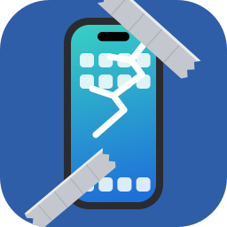

# scrcrappy

scrcpy for iOS, the crappy way: mirror and control an iPhone over USB. Held together with glue and
duct tape, and it works anyway.

## Install

**Linux** (Fedora shown; usbmuxd and libusb are on most desktops already):

```sh
sudo dnf install pipx usbmuxd
pipx install https://github.com/atreb92/scrcrappy/releases/download/v0.2.0/scrcrappy-0.2.0-py3-none-manylinux_2_35_x86_64.whl
```

Until the repo is public: `scripts/build-qvh.sh && pipx install .` from a checkout (needs the
Development packages below). Bluetooth mode also needs `sudo dnf install python3-dbus python3-gobject`.

**macOS** (untested):

```sh
brew tap atreb92/scrcrappy
brew install scrcrappy
```

Then run `scrcrappy` from anywhere. Releases: [docs/releasing.md](docs/releasing.md).

## Development

Fedora:

```sh
sudo dnf install golang libusb1-devel
```

macOS: `brew install go libusb pkg-config`

```sh
scripts/build-qvh.sh            # patched qvh -> scrcrappy/bin/qvh
python3 -m venv .venv && .venv/bin/pip install -e '.[dev]'
```

## Run

Plug in the iPhone, unlock it, trust the computer, then:

```sh
.venv/bin/scrcrappy
```

## Why a patched qvh

[qvh](https://github.com/danielpaulus/quicktime_video_hack) speaks the QuickTime USB
mirroring protocol. `third_party/qvh.patch` makes two changes:

- skip the endpoint clear-halt before reading: on Linux it dropped the PING the phone
  queues right after switching to the mirroring config, so streaming never started;
- write video unbuffered, so a still screen doesn't sit in a 4 KB buffer.
- drop qvh's own GStreamer window and audio commands (scrcrappy only runs `qvh record`), so it needs
  nothing but libusb at runtime.
- drop qvh's pairing check, the only use of go-ios (AGPL-3.0), so everything shipped stays permissively
  licensed; the licences of qvh and its Go modules ship as `scrcrappy/bin/qvh-LICENSES.txt`.

## Licence

MIT, see [LICENSE](LICENSE).

## Credits

- [scrcpy](https://github.com/Genymobile/scrcpy): the original. scrcrappy borrows its idea and most of its
  name, and is built and held together with glue and duct tape to make the same thing work on iOS.
- [qvh](https://github.com/danielpaulus/quicktime_video_hack) (MIT): the QuickTime USB protocol behind
  the video; scrcrappy ships a patched build (`third_party/qvh.patch`).
- ZXTouch: showed how touches can be injected from SpringBoard on a jailbroken iPhone. crappytouch
  follows the same approach as a clean rewrite and contains none of its code.
- [Inter](https://github.com/rsms/inter) (SIL OFL 1.1): the interface font, subset to Latin
  (`scrcrappy/fonts/`, licence in `OFL.txt` there; rebuilt by `scripts/make-fonts.sh`).
- [Material Symbols](https://github.com/google/material-design-icons) (Apache 2.0): the toolbar icons
  (`scrcrappy/icons/`, licence in `LICENSE` there).

## Mouse control without jailbreak

A BLE mouse drives the AssistiveTouch cursor. Pick where it comes from with `--mouse`:

- `--mouse ble`: this computer's Bluetooth adapter (Linux only).
- `--mouse esp32 --port /dev/ttyUSB0`: an ESP32 / ESP32-C3 / ESP32-S3 running
  `firmware/esp32-mouse` (works from Linux and macOS). Flash it once with PlatformIO:
  `cd firmware/esp32-mouse && pio run -e esp32dev -t upload` (env per board in `platformio.ini`).
  On the phone it is called "scrcrappy ESP32" (the laptop helper: "scrcrappy PC").

Either way the phone sees a BLE mouse; the phone shows it as the AssistiveTouch
cursor, and scrcrappy steers that cursor to follow your mouse over the window.

1. iPhone: Settings > Accessibility > Touch > AssistiveTouch: on.
2. For `ble` only: `sudo dnf install python3-dbus python3-gobject` (the helper runs under the system python).
3. `.venv/bin/scrcrappy --mouse ble` (or `esp32`), then on the phone pair the mouse
   (AssistiveTouch > Devices > Bluetooth Devices).
4. Once per phone, after changing AssistiveTouch Tracking Speed, or when the cursor overshoots / falls
   short: open a plain light screen (e.g. Settings) and click **Calibrate** in the toolbar's Settings
   (or run `scrcrappy --mouse ble --calibrate`, or `esp32`).

Click = tap, drag = drag, wheel = scroll (`--natural-scroll` inverts it).

The same BLE device is also a keyboard: keys typed in the window go to the phone by physical
position, so set the phone's hardware layout to match your computer's
(Settings > General > Keyboard > Hardware Keyboard, per language). iOS uses the layout of the
*active* input language: Ctrl+Space in the window switches it. While connected, iOS hides the
on-screen keyboard.

After updating scrcrappy, if the device description changed: "Forget" it on the phone, run
`bluetoothctl remove <phone address>` (ble) or reflash (esp32), and pair again: iOS caches it. The cursor re-syncs in the top-left corner whenever the
mouse enters the window.

## Control with a jailbreak (crappytouch)

On a jailbroken phone, install [crappytouch](https://github.com/Atreb92/crappytouch) (a SpringBoard tweak, reached over USB
only) and run `.venv/bin/scrcrappy --mouse agent` (or pick Agent in the toolbar's Settings once). No Bluetooth, no AssistiveTouch, no calibration:

- Click / drag = touch at that exact spot; **Ctrl+drag** = two-finger pinch around the screen centre;
  wheel = short swipe (`--natural-scroll` applies).
- Keys go to the phone by physical position (same Hardware Keyboard layout note as below); held keys repeat.
- Paste (**Ctrl+Shift+V**) types any text, accents and emoji included. iOS shows *Allow Paste* in the app
  (Settings › ‹app› › Paste from Other Apps › Allow stops it); the text stays on the phone's clipboard.
- Toolbar: Copy (phone clipboard → computer), Screenshot (PNG in your Pictures folder, or the folder in Settings), Home, App switcher, Lock.

On the phone, Settings › crappytouch › *Keep Awake While Connected* stops auto-lock while scrcrappy is connected.

First run: unlock the phone; it asks *Allow “‹computer›” to control this iPhone?* with a 6-digit code —
check it matches the one in the terminal, tap Allow. After each phone reboot, touch its screen once
before clicks work (the terminal says so).

## AI control

Let an AI agent (Claude Code, other MCP clients, any script) look at and drive the phone. Coordinates are
**percent** (0–100, decimals ok) of the upright screenshot: x from the left, y from the top.

**From any shell, jailbreak mode** (one action per call, no window needed, about half a second each):

```sh
scrcrappy agent --screenshot s.png      # {"ok": true, "path": "s.png", "width": 750, "height": 1334, "orientation": "portrait"}
scrcrappy agent --tap 50,30
scrcrappy agent --long-press 50,30,1500 # optional duration in ms (default 1000)
scrcrappy agent --swipe 50,80,50,20     # optional ,ms (default 300)
scrcrappy agent --type "hello"          # keys if a US keyboard can type it, else paste ("typed_with")
scrcrappy agent --clipboard
scrcrappy agent --home                 # also --switcher (Home twice) and --lock
scrcrappy agent --apps                 # {"ok": true, "apps": [{"id": "com.apple.mobilenotes", "name": "Notes", "running": false}, …]}
scrcrappy agent --open Notes           # by name (any case) or bundle id; replies before the app has drawn
scrcrappy agent --open-url https://example.com   # any scheme: https:, tel:, maps:, app deeplinks (agent 0.5.0)
```

Each prints one JSON object; on failure `{"ok": false, "error": "…"}` and exit code 1.

**MCP, in the running window** (any input mode): turn on *Allow AI control (MCP)* in the toolbar's Settings
(or start with `--mcp`), click *Copy MCP config* and paste it into your AI client's MCP settings. It is the
server entry most clients take:
`{"mcpServers": {"scrcrappy": {"type": "http", "url": "http://127.0.0.1:7331/mcp", "headers": {"Authorization": "Bearer …"}}}}`
(the token is created once and kept in `config.json`; some clients also have their own add command that
takes the same URL and header).
Tools: `screenshot` (the image plus width, height, orientation), `tap`, `long_press`, `swipe`, `type_text`,
`clipboard`, `home`, `switcher`, `lock`, `list_apps`, `open_app` and `open_url` in jailbreak mode, and in Bluetooth / ESP32 mode `check_pointer` (move without
clicking, report how far the cursor landed from the target) and `calibrate`; both need a plain, light screen
(Settings scrolled to the top) open on the phone; on a busy screen `check_pointer` can mistake a grey icon for
the cursor and report a bogus error. The server only listens on this computer and needs the token.

While AI control is on, a dot at the left of the toolbar shows its state: **green** waiting, **yellow** an AI
has been active in the last 30 s, **red** an AI action is running and your mouse and keyboard are paused.
A red ring marks where the AI touched.

Limits: reading the clipboard fails when the phone asks *Allow Paste* (it can't be answered remotely);
typing accents or emoji pastes, which may ask too; in Bluetooth / ESP32 mode typing is US layout, ASCII
only, and the orientation is just portrait or landscape.

## Toolbar

A bar along the bottom of the phone window holds the buttons. Hover a button for its name.
The window keeps the phone's aspect ratio when you resize it, and follows the phone when it rotates.

| Button | Does |
|---|---|
| Paste | Types the computer's clipboard into the phone (also **Ctrl+Shift+V**). US layout, printable ASCII + Enter/Tab; other characters are skipped and reported. |
| Copy | Phone clipboard → computer, with `--mouse agent` only (a Bluetooth keyboard/mouse can't read the phone's clipboard). |
| Screenshot | Saves a PNG (your desktop's Pictures folder, e.g. `~/Pictures` or `~/Immagini`, else your home folder; or the folder in Settings) and says where in a short message over the toolbar. With `--mouse agent` it is the phone's own screen; otherwise the mirrored video frame. |
| Custom buttons | Click a mouse button (2–5) that you bind to any AssistiveTouch action on the phone. Right-click one to edit or remove it. |
| + | Adds a custom button: pick an icon and a name, then follow the steps it shows to bind it on the phone (it has a *Send button N* button for the step where iOS asks you to press one). |
| Settings (gear) | Input mode (and ESP32 port) used when `--mouse` / `--port` aren't given — applies next launch; natural scrolling; AI control (MCP); pointer calibration (Bluetooth / ESP32); screenshot folder (… opens the desktop's folder picker: zenity on Linux). Opens as a panel over the phone image; closes with Esc, a click outside it, or when the window loses focus. |

Custom buttons are remembered per phone and per Bluetooth device (scrcrappy PC and scrcrappy ESP32
each have their own mapping on the phone). The toolbar's state is saved in
`~/.config/scrcrappy/config.json`: custom buttons and the Settings (input mode, natural scrolling, screenshot folder).
`--natural-scroll` / `--no-natural-scroll` override the saved scrolling direction.

After updating to the 5-button version, forget and re-pair the device on the phone once.

On Linux scrcrappy runs as a native Wayland window in a Wayland session and falls back to X11 if that can't
start; `--x11` forces X11 (XWayland on a Wayland desktop). Setting `SDL_VIDEODRIVER` yourself overrides both.
Everything but the add-button dialog is drawn inside the phone window, so nothing depends on window placement;
the dialog is a window of its own that the compositor places.

Wayland shows a window's icon from a desktop entry that matches its app id (`scrcrappy`), so without one the window
has a generic icon. To add it for your user (untested): copy `packaging/scrcrappy.desktop` to
`~/.local/share/applications/` and `scrcrappy/icons/scrcrappy.png` to
`~/.local/share/icons/hicolor/256x256/apps/scrcrappy.png`.
